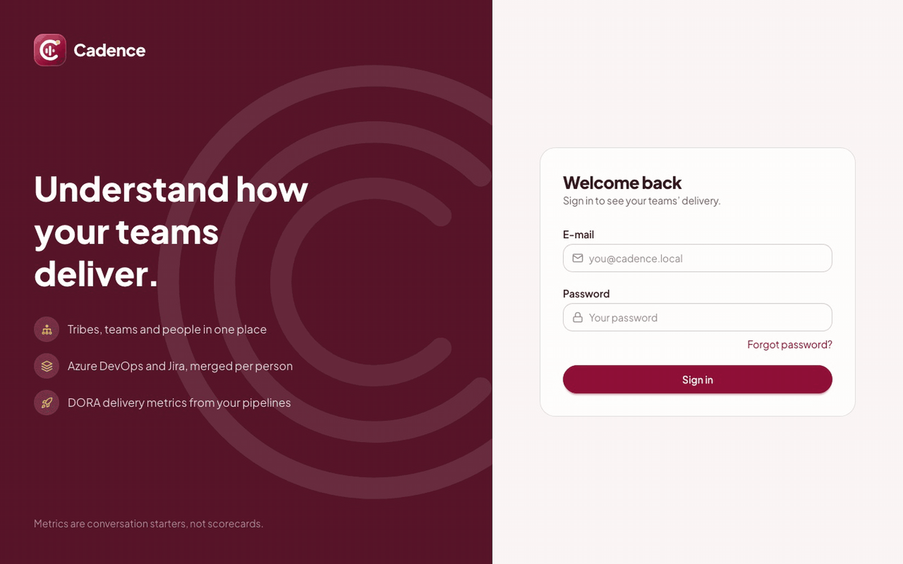
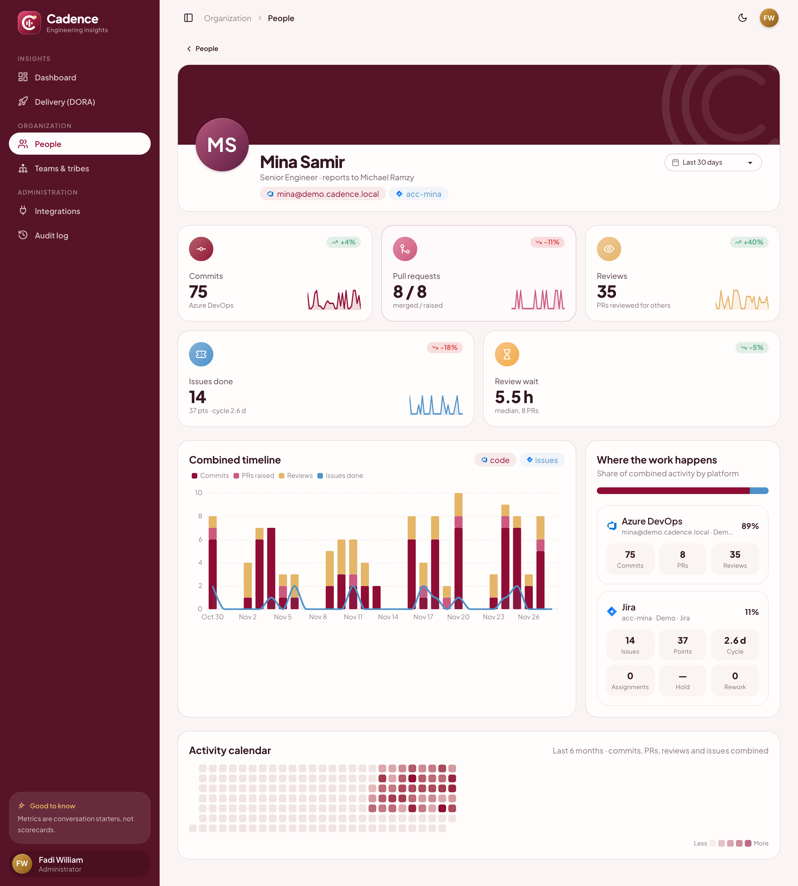
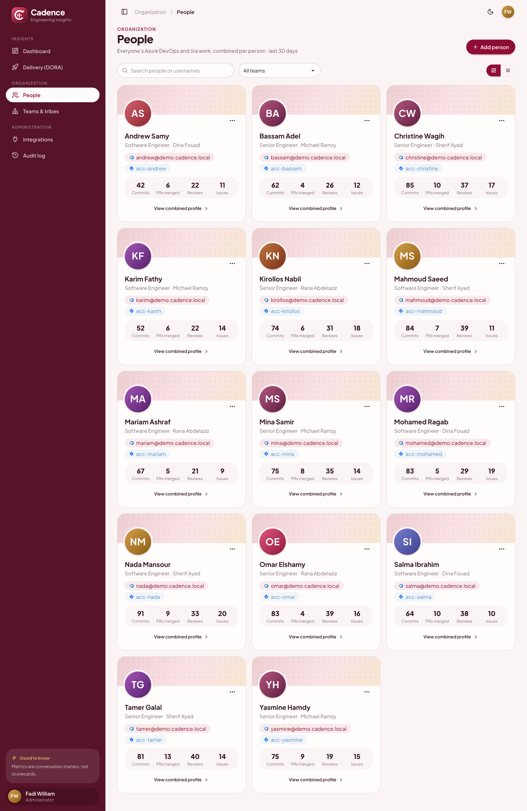
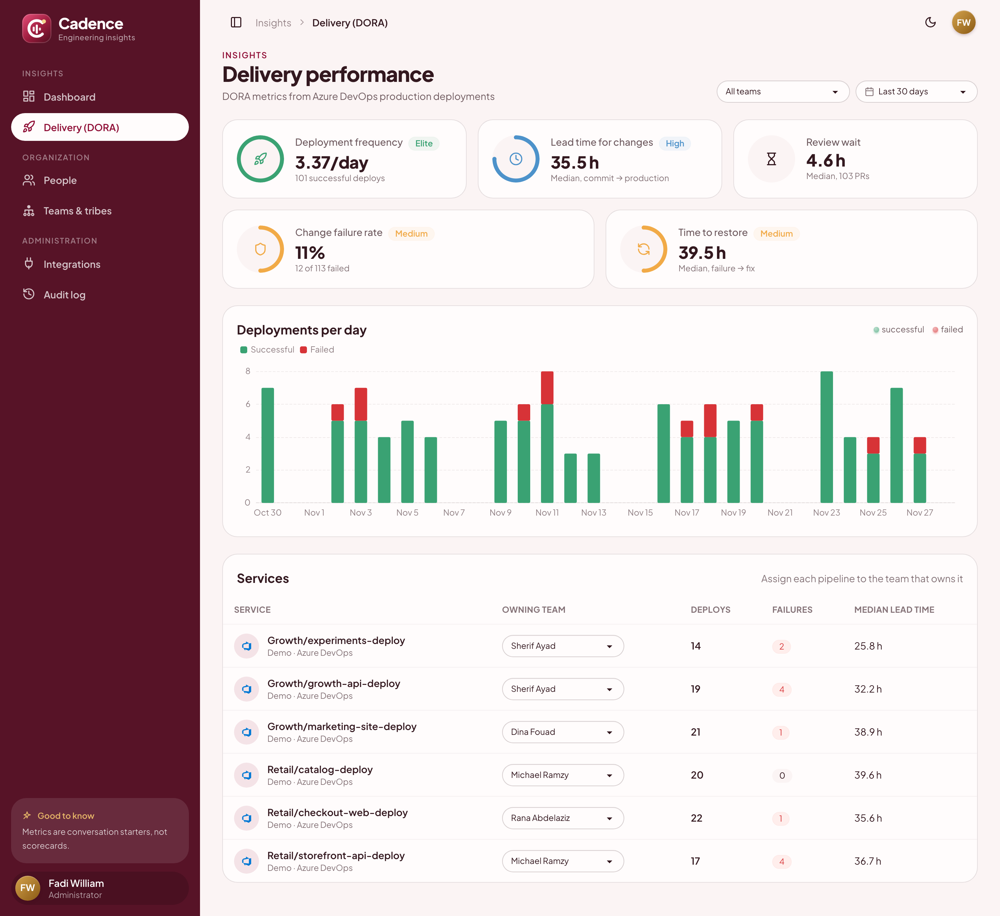
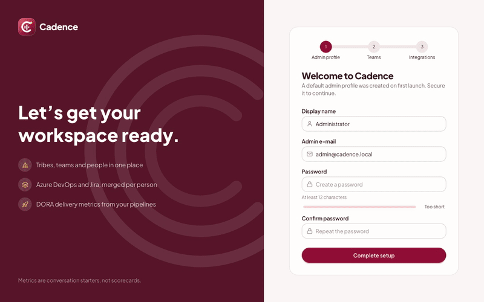
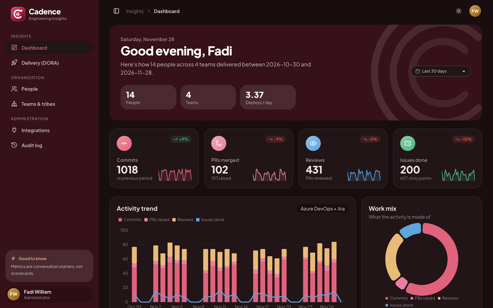
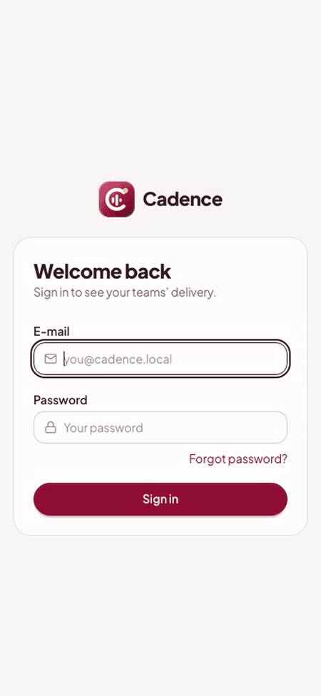

<p align="center">
  
</p>

<h1 align="center">Cadence</h1>

<p align="center">
  <strong>See how your engineering teams deliver, with Jira and Azure DevOps in one place.</strong><br />
  Self-hosted · Open source · Built for engineering leaders who want insight, not leaderboards.
</p>

<p align="center">
  <a href="https://cadence.fadiwilliam.com/"><strong>Website & docs</strong></a> ·
  <a href="docs/guide/getting-started.md">Get started</a> ·
  <a href="docs/guide/jira.md">Connect Jira</a> ·
  <a href="docs/guide/azure-devops.md">Connect Azure DevOps</a> ·
  <a href="LICENSE">Apache-2.0</a>
</p>

<p align="center">
  
</p>

---

## Why Cadence?

Your delivery data is split across tools. Work items live in **Jira**; code, reviews and pipelines live in
**Azure DevOps**. Answering simple questions (_"How is the Retail tribe trending?"_, _"Who's carrying the
review load?"_, _"Are we deploying more often than last quarter?"_) means hopping between dashboards and
spreadsheets.

Cadence brings it together:

- **Your organization, as it really is.** Tribes, tribe leads, engineering managers and their people,
  each seeing exactly their own slice.
- **One combined profile per person.** Each person's Jira issues and Azure DevOps commits, pull requests and
  reviews merged into one timeline, scorecard and activity calendar.
- **DORA metrics out of the box.** Deployment frequency, lead time, change failure rate and time to restore
  from your Azure DevOps pipelines, rated _Elite → Low_, plus how long pull requests wait for a first review.
- **Team and tribe roll-ups.** Switch the dashboard between people, teams and tribes over any date range,
  with trends against the previous period.

## Highlights

- **Guided first launch.** A secure setup screen creates your admin account. No config files to edit.
- **Role-aware by design.** Managers see their team, tribe leads their tribe, admins everyone.
- **Smart account linking.** Type a name and Cadence finds the matching Jira and Azure DevOps accounts.
- **Fresh data.** Nightly syncs, one-click backfills, and optional webhooks for updates within a minute.
- **Pick what each connection syncs.** Track work in Jira or Azure Boards, and turn each feature of a
  connection on or off, keeping or removing the data it already collected.
- **Private by default.** Runs on your infrastructure. Read-only tokens, encrypted at rest. Full audit log.
- **Works on any screen.** Every page adapts to phones and tablets, with a bottom navigation bar on small
  screens, plus light and dark themes.
- **Extensible.** Add GitHub, GitLab, Linear or an in-house tool by writing a single adapter class.

## See it

| Combined person profile                | People                                 | Delivery (DORA)                            |
| -------------------------------------- | -------------------------------------- | ------------------------------------------ |
|  |  |  |

| First launch                             | Dark mode                                    | On your phone                         |
| ---------------------------------------- | -------------------------------------------- | ------------------------------------- |
|  |  |  |

## Get started in 3 commands

You'll need **Docker**. Everything else (database, queue, API and web app) runs in containers.

```bash
git clone https://github.com/fadi-william/Cadence.git && cd Cadence
export JWT_SECRET=$(openssl rand -base64 48) APP_ENCRYPTION_KEY=$(openssl rand -base64 32)
docker compose --profile app up -d --build
```

Open **http://localhost:8080** and follow the welcome screen to create your admin account.

Then:

1. **Build your organization**: add tribe leads, engineering managers and their people.
2. **Connect your tools**: [Jira](docs/guide/jira.md) and [Azure DevOps](docs/guide/azure-devops.md)
   with read-only tokens.
3. **Link identities**: tell Cadence which accounts belong to whom; it suggests matches as you type.
4. **Sync** and explore. From then on Cadence refreshes itself every night.

Want to look around first? Run `npm run db:seed:demo` to load a demo organization with 60 days of
activity. The [getting started guide](docs/guide/getting-started.md) covers production settings,
running without Docker and every configuration option.

## Your data stays yours

- **Self-hosted.** Cadence runs where you run it. Your delivery data never leaves your infrastructure.
- **Read-only.** Cadence only reads from Jira and Azure DevOps and asks for the smallest scopes that work.
- **Encrypted.** Integration tokens are encrypted at rest (AES-256-GCM) and never shown again after saving.
- **Accountable.** Sign-ins, changes and syncs are recorded in an audit log, with who did what, and when.
- **Secure sessions.** Short-lived sign-ins, rotating session cookies, rate-limited sign-in endpoints, and
  one-time password-reset links.

## Measure responsibly

Commits and story points are **signals, not scores**. Cadence is designed for spotting trends,
bottlenecks and wins at the **team** level, and for better 1:1 conversations, not for ranking people.
Read [how metrics work](docs/guide/metrics.md) to see exactly what each number means.

## Documentation

| Guide                                              |                                                            |
| -------------------------------------------------- | ---------------------------------------------------------- |
| [Getting started](docs/guide/getting-started.md)   | Install, first launch, roles, demo data, configuration     |
| [Connect Jira](docs/guide/jira.md)                 | Tokens, linking people, story points, webhooks             |
| [Connect Azure DevOps](docs/guide/azure-devops.md) | PAT scopes, deployments and DORA, service hooks            |
| [How metrics work](docs/guide/metrics.md)          | Definitions, DORA ratings, data freshness, responsible use |
| [Add a provider](docs/guide/adapters.md)           | Write an adapter for another platform                      |
| [Architecture](docs/ARCHITECTURE.md)               | How Cadence is built, for contributors                     |

The same guides are on the **[Cadence website](https://cadence.fadiwilliam.com/)**.

## Contributing

Cadence is an Angular + NestJS monorepo (`apps/web`, `apps/api`, `apps/site`, `packages/shared`).

```bash
npm install && docker compose up -d
cp apps/api/.env.example apps/api/.env      # set JWT_SECRET and APP_ENCRYPTION_KEY
npm run db:migrate && npm run db:seed:demo
npm run dev:api & npm run dev:web
```

`npm test` runs unit tests, `npm run test:int` the API integration tests and `npm run test:e2e` the
Playwright suite. Bug reports and pull requests are welcome; adding a provider is a great first contribution.

## License

Cadence is open source under the [Apache License 2.0](LICENSE). See [NOTICE](NOTICE) for attribution.
